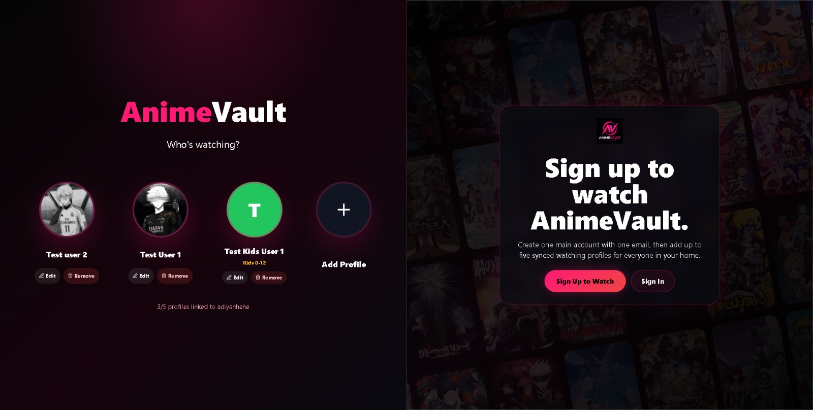
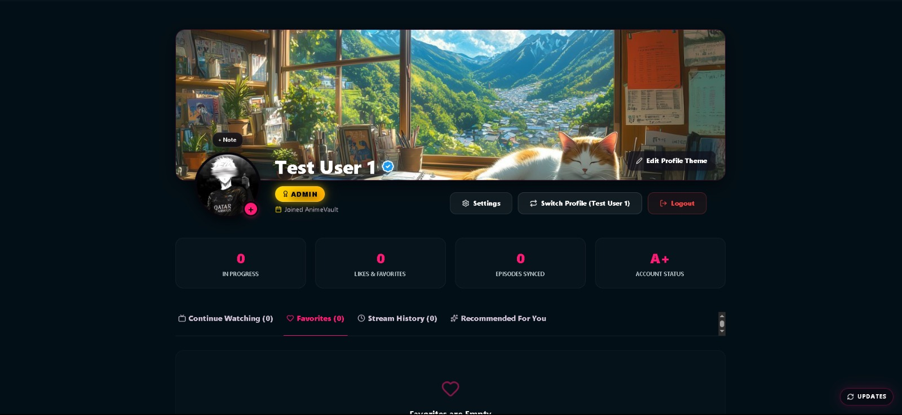
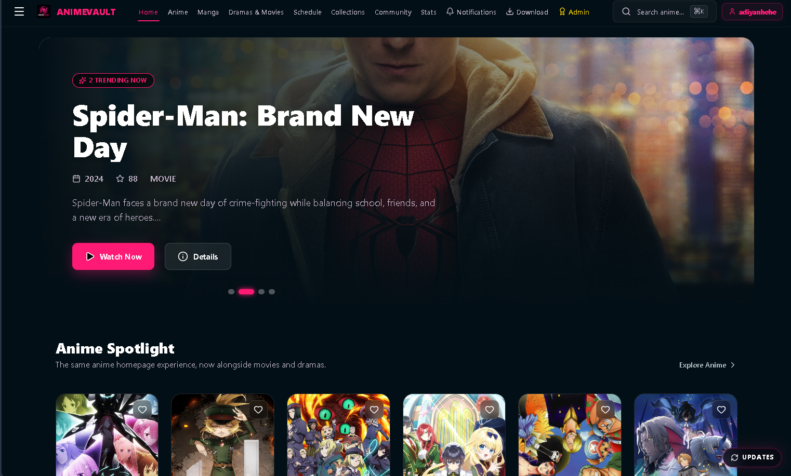
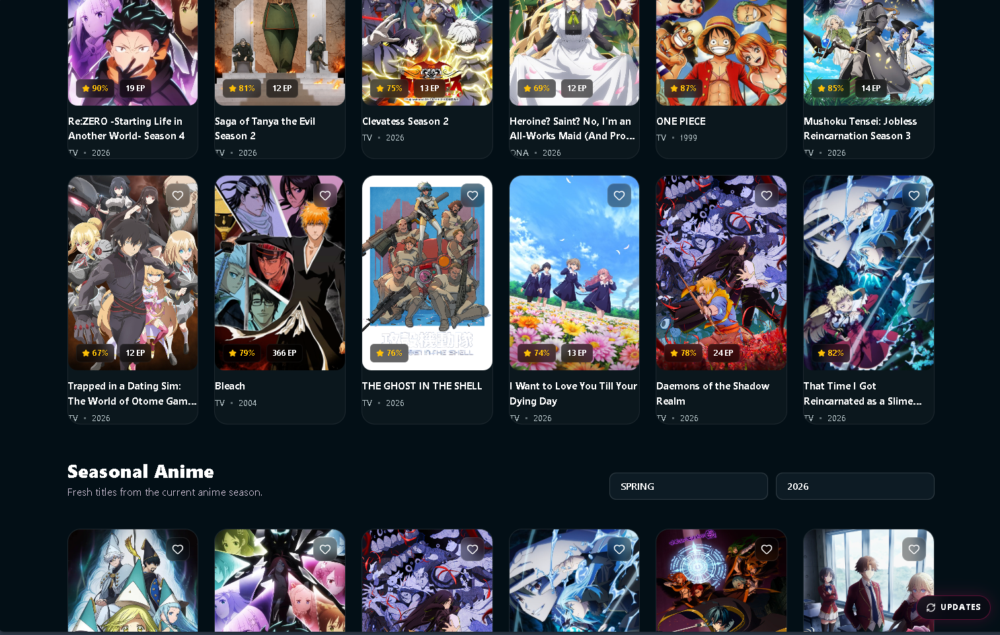
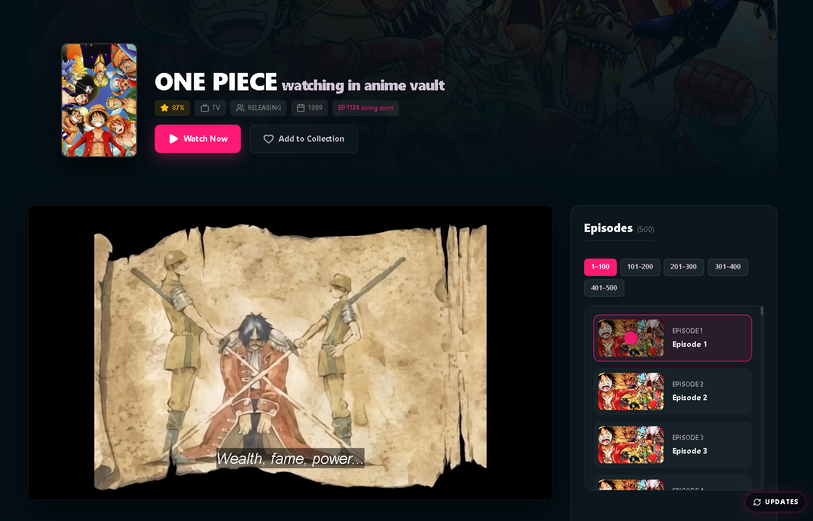
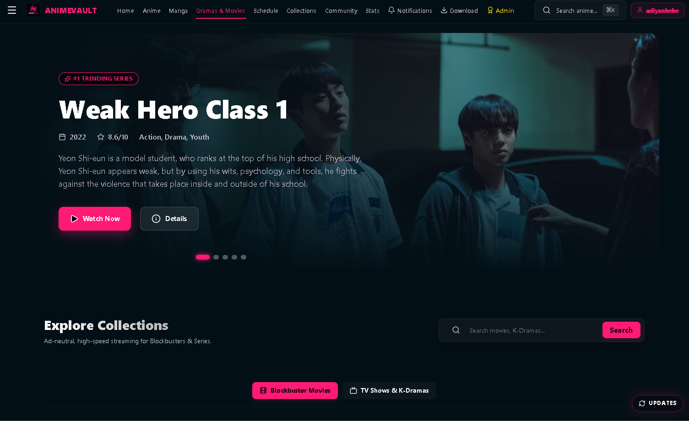
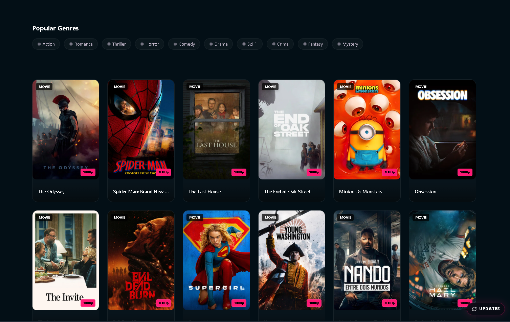
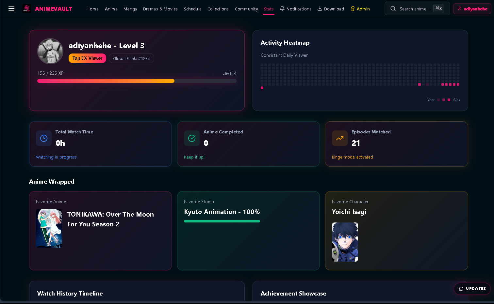

# AnimeVault

> Discover anime, movies, dramas, and manga, then keep your favorites and viewing progress together in one library.

---

## 📸 Preview

  
  
  
  
  
  
  
  

---

## Features

* **Playback:** Use the available player and provider options for supported titles.
* **Discover:** Browse [anime](https://animevaultofficial.fun/#/search?type=ANIME), [dramas and movies](https://animevaultofficial.fun/#/dramas-movies), and [manga](https://animevaultofficial.fun/#/search?type=MANGA).
* **Progress tracking:** Save viewing history and return to titles you were watching.
* **Cross-platform:** Desktop installers for Windows, macOS, and Linux, plus an Android APK when a matching release is available.
* **🔍 Instant Search:** Quick-launch search functionality powered by keyboard shortcuts ($\text{Cmd/Ctrl + K}$).

---

## 📥 Downloads & Installation

Get the latest release assets directly from [GitHub Releases](https://github.com/animevaultofficial/animevaultofficial.github.io/releases/latest).

| Platform | Recommended Asset | Description |
| :--- | :--- | :--- |
| **Windows** (`10 / 11`) | [AnimeVault Windows x64 installer](https://github.com/animevaultofficial/animevaultofficial.github.io/releases/latest/download/AnimeVault-Windows-x64.exe) | Fast native desktop installer with auto-updates. |
| **macOS** (`12+`) | [AnimeVault macOS Apple Silicon installer](https://github.com/animevaultofficial/animevaultofficial.github.io/releases/latest/download/AnimeVault-macOS-arm64.dmg) | Apple Silicon DMG installer. |
| **Linux** (`Ubuntu/Debian`) | [AnimeVault Linux x64 AppImage](https://github.com/animevaultofficial/animevaultofficial.github.io/releases/latest/download/AnimeVault-Linux-x64.AppImage) | Portable AppImage build (make executable and run). |
| **Android** (`6+`) | [AnimeVault Android APK](https://github.com/animevaultofficial/animevaultofficial.github.io/releases/latest/download/Anime%20Vault.apk) | Sideloadable mobile app release. |

---

## 🚀 Tech Stack & Pipeline

* **Frontend:** Responsive web app with dynamic routing for Anime, Manga, Schedule, Collections, and User Profiles.
* **CI/CD:** Automated builds, packaging, and tagging straight to GitHub Releases via package management workflows.

---

## ⚠️ Disclaimer

> AnimeVault does not store any files on its servers. All contents are provided by non-affiliated third parties.

---

© 2026 AnimeVault. All rights reserved.
